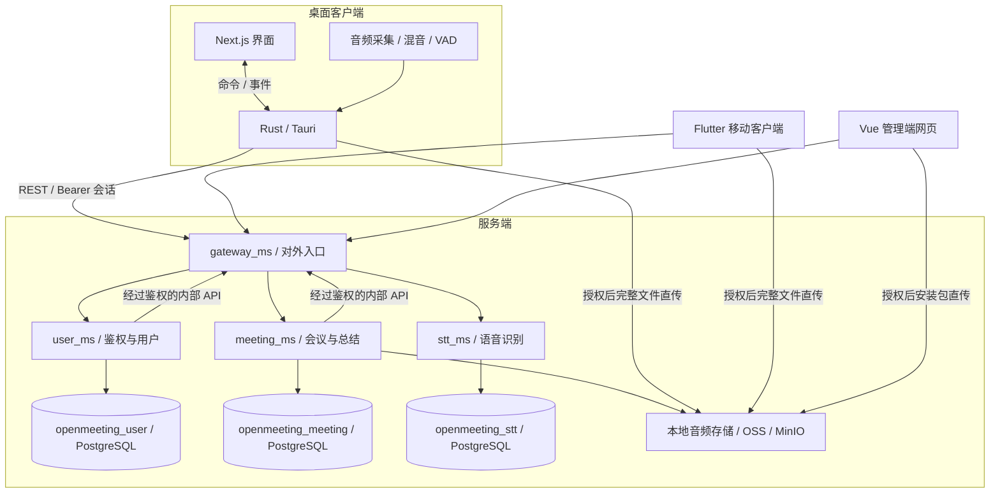

# 系统架构

深应会议 采用客户端与服务端架构。桌面客户端由 Next.js 界面和 Rust/Tauri 原生层组成，负责音频采集、预处理及服务端通信。FastAPI 微服务负责转写、会议数据存储和大模型总结。Flutter 移动客户端使用同一套服务端 API。

## 总体架构图

## 组件说明

### 桌面客户端（`frontend/`）

- Next.js/React 提供界面。V2 Aurora Dark 的视觉规范见[桌面 UI 规范](../frontend/UI_design.md)。
- Rust/Tauri 采集麦克风和系统音频，进行混音及本地语音活动检测，并上传语音分段供服务端转写。录音流程还会在上传前将音频保存到本地。
- Tauri 命令和事件连接界面与原生层。原生层的服务端客户端负责会话、鉴权请求、心跳及后台任务轮询。
- 会议记录、转写、笔记和总结均存储在服务端；当前桌面端不运行本地 STT 模型，也不使用本地会议数据库。

### 服务端（`server/`）

| 服务 | 职责 | 数据库 |
|---|---|---|
| `gateway_ms` | 端口 39110 上的统一对外入口；负责会话及管理员鉴权、身份转发、HTTP 与会议房间 WebSocket 代理，以及托管 `/admin` | `openmeeting_user`（只读会话校验） |
| `user_ms` | 手机号鉴权、会话、用户、客户端版本发布及 IM 票据交换 | `openmeeting_user` |
| `meeting_ms` | 会议、转写、总结、笔记、音频、任务、预定会议及会中信令 | `openmeeting_meeting` |
| `stt_ms` | 语音识别引擎、模型下载和模型切换 | `openmeeting_stt` |

各业务服务分别使用独立的 PostgreSQL 容器及持久化卷，对应容器为 `user-postgres`、`meeting-postgres` 和 `stt-postgres`。网关通过用户数据库校验会话。详见[数据库归属与隔离](database-isolation.md)。

服务间 HTTP 请求也统一经过 gateway_ms：`/internal/{user|meeting|stt}/{path}` 会转发到目标服务的 `/internal/{path}`。该网关入口即使在开发环境中也要求配置 `X-Internal-Token`，并会移除调用方传入的身份及 Cookie；不接受任意目标 URL，也不允许转发到内部命名空间之外的路由。只有网关配置直连下游服务的 URL。外部 IM 回调从网关进入，user_ms 同时校验网关注入的内部令牌和平台签名。第三方平台 SDK、OSS、短信、大模型、云端 ASR 和模型下载使用网关在内部端口 39111 提供的独立鉴权正向代理。各业务容器使用独立内部网络，不能直接访问 edge 网络。详见[统一出入网关](unified-egress.md)。会议音频使用服务端本地存储或已配置的 OSS。

部署步骤见[服务端指南](../server/README.md)；客户端、管理端及 Tauri 命令的契约见[API 契约](../server/API.md)。

### 移动客户端与管理端

- `mobile/` 为 Flutter 客户端，其架构及功能边界见[移动端开发指南](../mobile/DEVELOPMENT.md)。
- `server/admin-web/` 为 Vue 3 / Element Plus 管理界面，由网关托管。

## 实现边界与专题入口

系统图描述模块关系，不作为当前功能完成清单或测试报告。接口字段及命令以[API 契约](../server/API.md)为准，实际实现和未验收项见[功能状态](feature-status.md)。

会议业务状态、IM 消息和 RTC 媒体的职责见[聊天说明](meeting-im-chat.md)及[连接生命周期](meeting-resilience.md)。当前屏幕共享传输与兼容边界见[第二路视频实现](im-rtc-second-video.md)。

录制、共享记录、预定及恢复的当前范围见[功能状态](feature-status.md)，验证方法见[测试入口](testing/README.md)。内部验收档案不随源码分发。目录职责见[项目结构](project-structure.md)，所有操作入口见[文档导航](README.md)。
